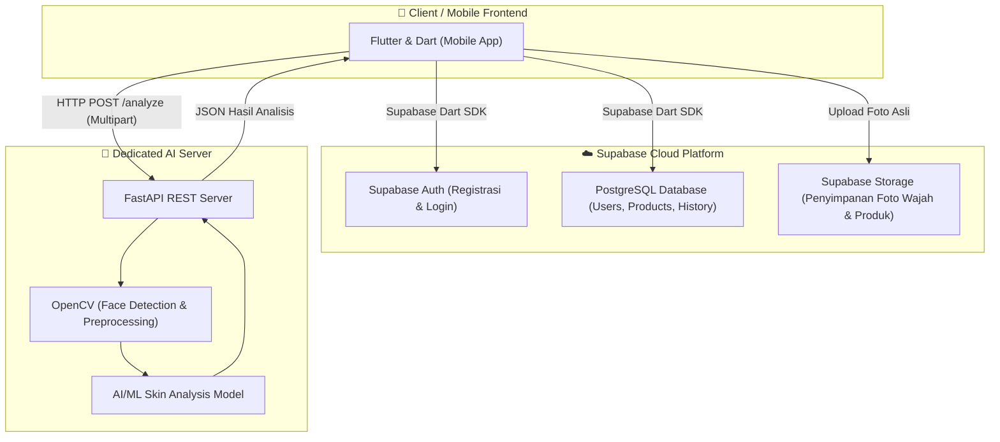
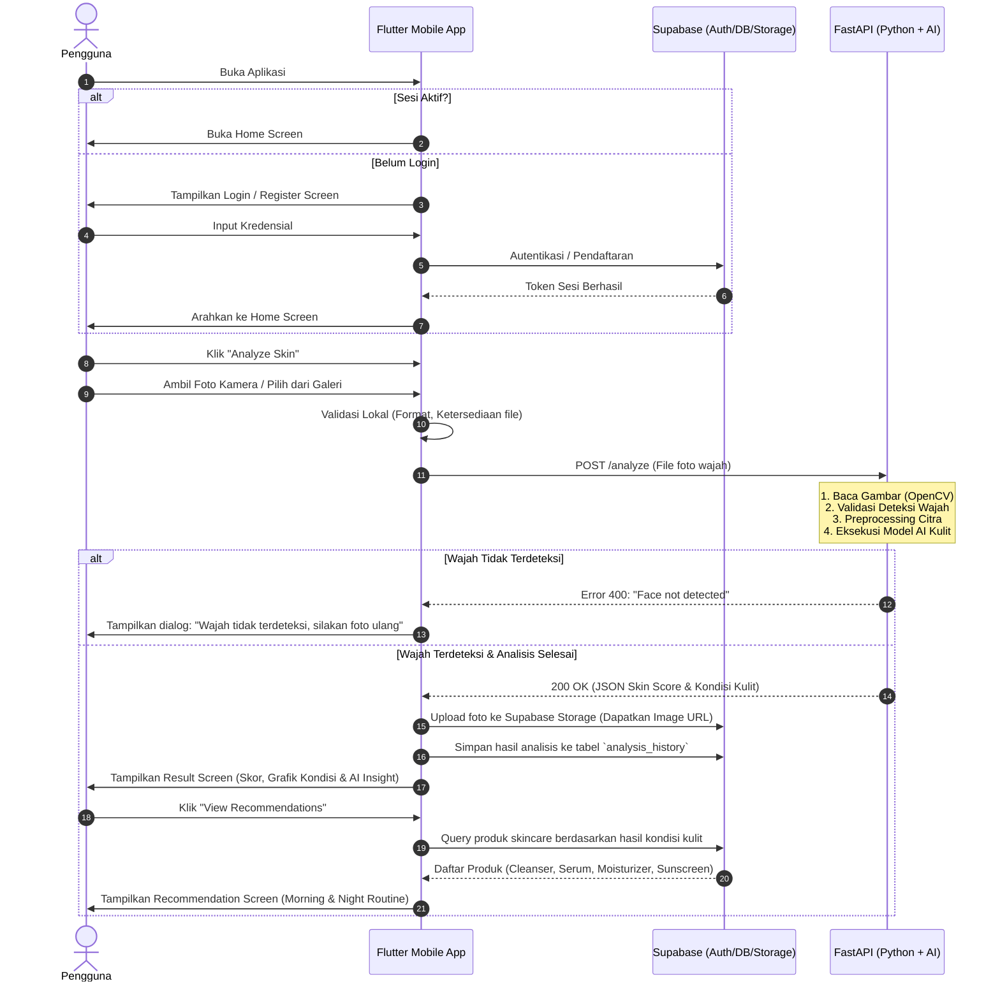

# 📘 DOKUMEN RANCANGAN ALUR SISTEM AISKIN
*(AI Skin Analysis & Skincare Recommendation)*

---

## 1. 📌 Ringkasan Eksekutif & Gambaran Aplikasi
**AISKIN** adalah aplikasi mobile berbasis Flutter yang mengintegrasikan kecerdasan buatan (Artificial Intelligence) dan layanan Backend-as-a-Service (Supabase) untuk menganalisis kondisi kesehatan kulit wajah pengguna dari foto, serta memberikan rekomendasi produk dan rutinitas perawatan kulit (*skincare routine*) yang terpersonalisasi.

---

## 2. 🏛️ Arsitektur Teknologi & Pembagian Peran



### Pembagian Tugas Setiap Komponen:
| Komponen | Teknologi | Tanggung Jawab Utama |
|---|---|---|
| **Frontend** | Flutter, Dart | • Desain antarmuka (UI/UX) responsif & interaktif<br>• Manajemen navigasi & state aplikasi<br>• Integrasi Kamera & Galeri perangkat<br>• Komunikasi API ke FastAPI & Supabase SDK |
| **Backend & Database** | Supabase | • Manajemen autentikasi pengguna (JWT, Session)<br>• Penyimpanan profil pengguna, katalog produk, dan riwayat analisis<br>• Penyimpanan berkas foto wajah terenkripsi/aman (Storage bucket) |
| **AI Server Engine** | Python, FastAPI | • Penyedia REST API endpoint pemrosesan citra<br>• Deteksi keberadaan wajah menggunakan OpenCV (Haar Cascade / MediaPipe)<br>• Menjalankan inferensi model AI analisis kulit<br>• Menghitung skin score dan level kondisi kulit |
| **Recommendation Engine** | Rule-Based / Algoritmik | • Memetakan kombinasi hasil AI (*Skin Type, Acne, Oiliness, dll.*) ke kategori bahan aktif & produk skincare yang tepat |

---

## 3. 🔄 Alur Kerja Sistem (End-to-End Flow)



---

## 4. 📊 Skema Basis Data (Supabase PostgreSQL)

### 1. Tabel `users_profile`
Menyimpan profil detail pengguna yang berelasi dengan `auth.users` Supabase.
```sql
CREATE TABLE public.users_profile (
    id UUID PRIMARY KEY REFERENCES auth.users(id) ON DELETE CASCADE,
    name TEXT NOT NULL,
    email TEXT NOT NULL UNIQUE,
    avatar_url TEXT,
    created_at TIMESTAMP WITH TIME ZONE DEFAULT timezone('utc'::text, now()) NOT NULL
);
```

### 2. Tabel `products`
Menyimpan katalog produk skincare dan kriteria kecocokannya.
```sql
CREATE TABLE public.products (
    id UUID PRIMARY KEY DEFAULT gen_random_uuid(),
    name TEXT NOT NULL,
    brand TEXT NOT NULL,
    category TEXT NOT NULL, -- Cleanser, Toner, Serum, Moisturizer, Sunscreen, Treatment
    ingredients TEXT[],
    skin_type TEXT[] NOT NULL, -- ['Oily', 'Combination', 'Dry', 'Normal', 'Sensitive']
    suitable_for TEXT[] NOT NULL, -- ['Acne', 'Dullness', 'Dark Spot', 'Redness', 'Large Pores']
    routine_time TEXT NOT NULL, -- 'Morning', 'Night', 'Both'
    image_url TEXT,
    description TEXT,
    created_at TIMESTAMP WITH TIME ZONE DEFAULT timezone('utc'::text, now()) NOT NULL
);
```

### 3. Tabel `analysis_history`
Menyimpan jejak riwayat setiap analisis wajah yang dilakukan pengguna.
```sql
CREATE TABLE public.analysis_history (
    id UUID PRIMARY KEY DEFAULT gen_random_uuid(),
    user_id UUID NOT NULL REFERENCES auth.users(id) ON DELETE CASCADE,
    image_url TEXT NOT NULL,
    skin_type TEXT NOT NULL,      -- e.g., 'Combination'
    acne TEXT NOT NULL,           -- e.g., 'Moderate'
    oiliness TEXT NOT NULL,       -- e.g., 'High'
    dryness TEXT NOT NULL,        -- e.g., 'Low'
    spots TEXT NOT NULL,          -- e.g., 'Moderate'
    texture TEXT NOT NULL,        -- e.g., 'Moderate'
    skin_score INTEGER NOT NULL,  -- e.g., 78 (0-100)
    created_at TIMESTAMP WITH TIME ZONE DEFAULT timezone('utc'::text, now()) NOT NULL
);
```

---

## 5. 🧠 Logika Rekomendasi Skincare (Recommendation Engine)

Sistem rekomendasi menggunakan pendekatan berbasis aturan (*rule-based filtering*) yang mencocokkan kondisi kulit hasil analisis dengan atribut produk:

```text
Aturan Pemetaan:
1. Filter Tipe Kulit:
   products.skin_type CONTAINS analysis.skin_type

2. Filter Masalah Kulit Utama:
   - Jika acne == 'High' / 'Moderate'     -> Tambahkan target 'Acne'
   - Jika oiliness == 'High'              -> Tambahkan target 'Large Pores' / 'Sebum Control'
   - Jika spots == 'High' / 'Moderate'    -> Tambahkan target 'Dark Spot' / 'Dullness'
   - Jika dryness == 'High'               -> Tambahkan target 'Hydration'

3. Kelompokkan ke dalam Routine:
   - Rutinitas Pagi (Morning Routine):
     1. Cleanser (Gentle/Purifying)
     2. Hydrating Toner / Vitamin C Serum (Opsional)
     3. Lightweight / Barrier Moisturizer
     4. Sunscreen (Wajib SPF 30+)
   - Rutinitas Malam (Night Routine):
     1. Cleanser / Double Cleanse
     2. Active Treatment Serum (Salicylic Acid / Niacinamide / Retinoid / Hyaluronic Acid)
     3. Nourishing Night Moisturizer
```

---

## 6. 📱 Struktur Navigasi & Layar Flutter

```text
lib/
├── main.dart
├── core/
│   ├── constants/       # URL API, Supabase Config, Strings
│   ├── theme/           # Palet warna, Tipografi, Style Card
│   └── network/         # HTTP Client (Dio/Http) untuk FastAPI
├── data/
│   ├── models/          # Model data (User, AnalysisResult, Product)
│   └── repositories/    # Supabase Repository, AI Repository
└── presentation/
    ├── splash/          # Splash & Initializer Screen
    ├── auth/            # LoginScreen, RegisterScreen
    ├── home/            # HomeScreen (Greeting, Last Score, Quick Action)
    ├── camera/          # CameraScreen / ImagePicker Preview
    ├── result/          # ResultScreen (Skin score gauge, Radar/Bar chart, AI Insight)
    ├── recommendation/  # RecommendationScreen (Morning & Night Routine tab)
    ├── history/         # HistoryScreen & HistoryDetailScreen
    └── profile/         # ProfileScreen (Info akun, Pengaturan, Logout)
```

---

## 7. 🗓️ Roadmap Pengembangan Bertahap (Step-by-Step)

Prinsip utama: **Pengembangan modular dan terisolasi**. Frontend harus stabil dan dapat diuji secara mandiri dengan data dummy sebelum disambungkan ke Backend & AI.

| Tahap | Fokus Utama | Target Luaran (Deliverables) |
|---|---|---|
| **Tahap 1** | **Flutter UI & Mock Data** | Seluruh tampilan layar (Home, Result, Recommendation, History, Profile) selesai dengan desain rapi menggunakan data dummy statis. |
| **Tahap 2** | **Camera & Gallery Flow** | Integrasi `image_picker` / `camera`, validasi gambar lokal di Flutter, preview foto sebelum analisis. |
| **Tahap 3** | **Supabase Integration** | Implementasi autentikasi (Register/Login), database migration (`users_profile`, `products`, `analysis_history`), dan Supabase Storage bucket. |
| **Tahap 4** | **FastAPI Server Base** | Endpoint `POST /analyze` siap menerima multipart file dengan respon simulasi data JSON yang dinamis. |
| **Tahap 5** | **Python AI & Preprocessing** | Integrasi OpenCV untuk deteksi wajah (mengembalikan error jika wajah tidak tampak) dan modul estimasi skor kondisi kulit. |
| **Tahap 6** | **Integrasi End-to-End** | Menghubungkan alur lengkap: Flutter foto ➔ FastAPI analisis ➔ Simpan ke Supabase ➔ Tampilkan Result Screen. |
| **Tahap 7** | **Recommendation Engine** | Logika pemetaan hasil AI dengan katalog produk Supabase untuk menyusun rekomendasi rutinitas pagi & malam. |
| **Tahap 8** | **Testing & Optimasi** | Pengujian kasus batas (foto gelap, wajah miring, koneksi lambat), penanganan error UX, dan optimasi performa. |
